# Real-Time Human–Robot Safety System

A ROS 2–based system for real-time human sensing, human and robot dynamics
estimation, collision-risk assessment, and risk-aware speed control of an Indy7
collaborative robot.

This repository is the project hub for the complete system. The implementation
is maintained in two focused repositories so that the perception and robot
control pipelines can be developed independently while sharing a common ROS 2
interface.

<p align="center">
  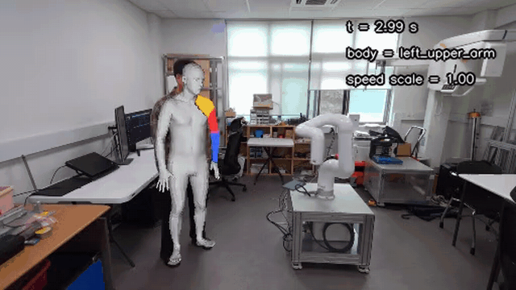
</p>
<p align="center">
  Online run on an Indy7. The speed scale drops as the robot approaches the
  worker's head and recovers as it moves away. Red, yellow, and blue markers
  indicate the top-three collision-risk body parts.
</p>

> [!NOTE]
> **Paper (manuscript to be submitted to IJCAS):** H. Kim, J. Lee, J. Choi,
> H. Shin, and S. Rhim, "Personalized Directional Human Effective Mass
> Estimation for Online Collision-Force Assessment and Speed Scaling of
> Collaborative Robots." [PDF](docs/paper/ijcas_manuscript.pdf)

## Directional human effective mass

The speed scale above depends on the human effective mass at the candidate
contact point. Instead of a fixed body-region value, the system computes it
from a personalized SMPL-based 19-segment model, so it changes with the
collision direction and with active joint range-of-motion (ROM) constraints.

<p align="center">
  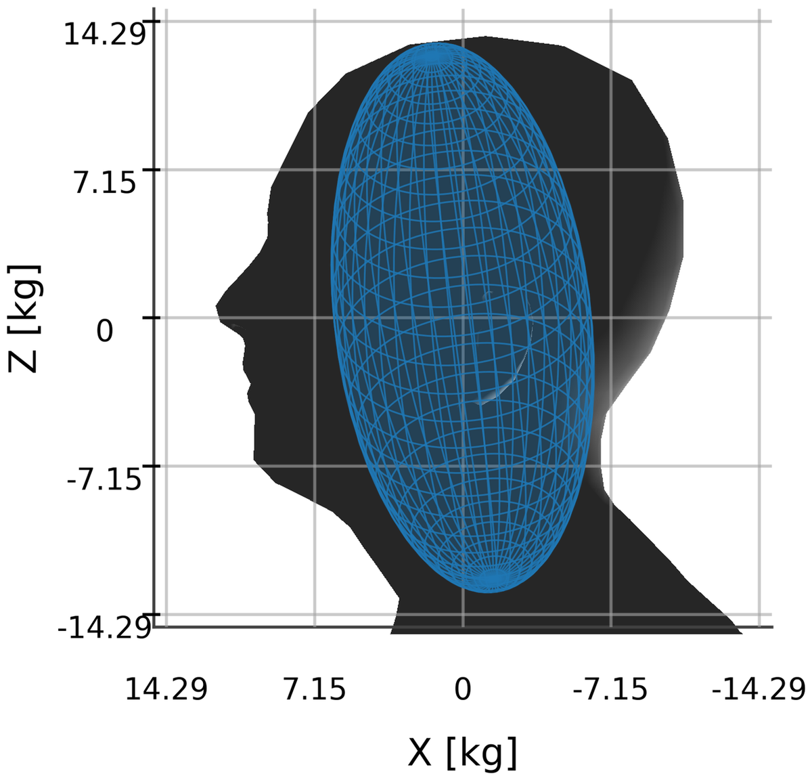
</p>
<p align="center">
  X–Z view of the mass-scaled principal effective-mass ellipsoid at the head.
  Longer semi-axes mean lower mobility. In this posture the principal effective
  masses range from 6.17 to 16.51 kg, about 2.7 times within one segment.
</p>

| (a) Collision direction and knee ROM constraint | (b) Ellipsoid without ROM constraint | (c) Ellipsoid with ROM constraint |
| :---: | :---: | :---: |
| 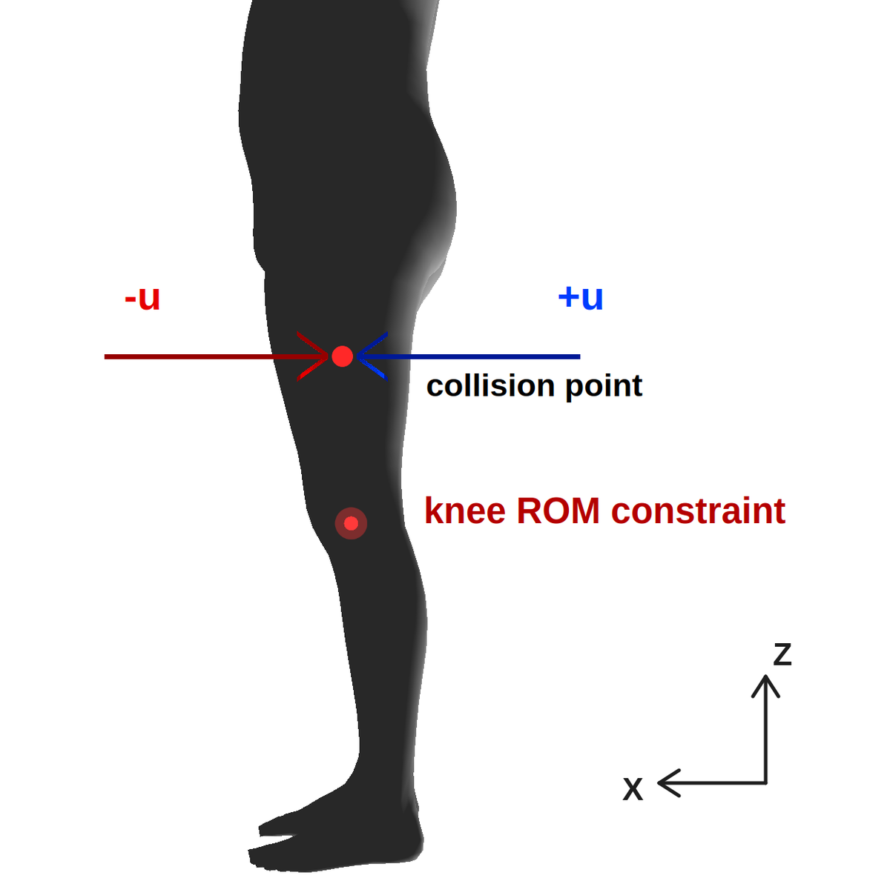 | 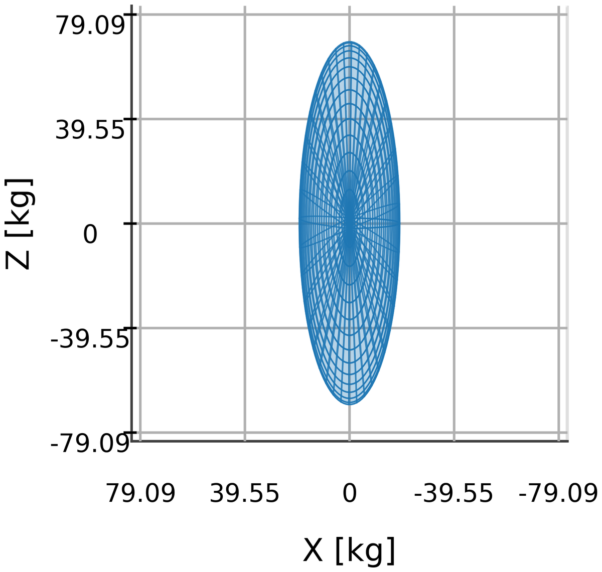 | 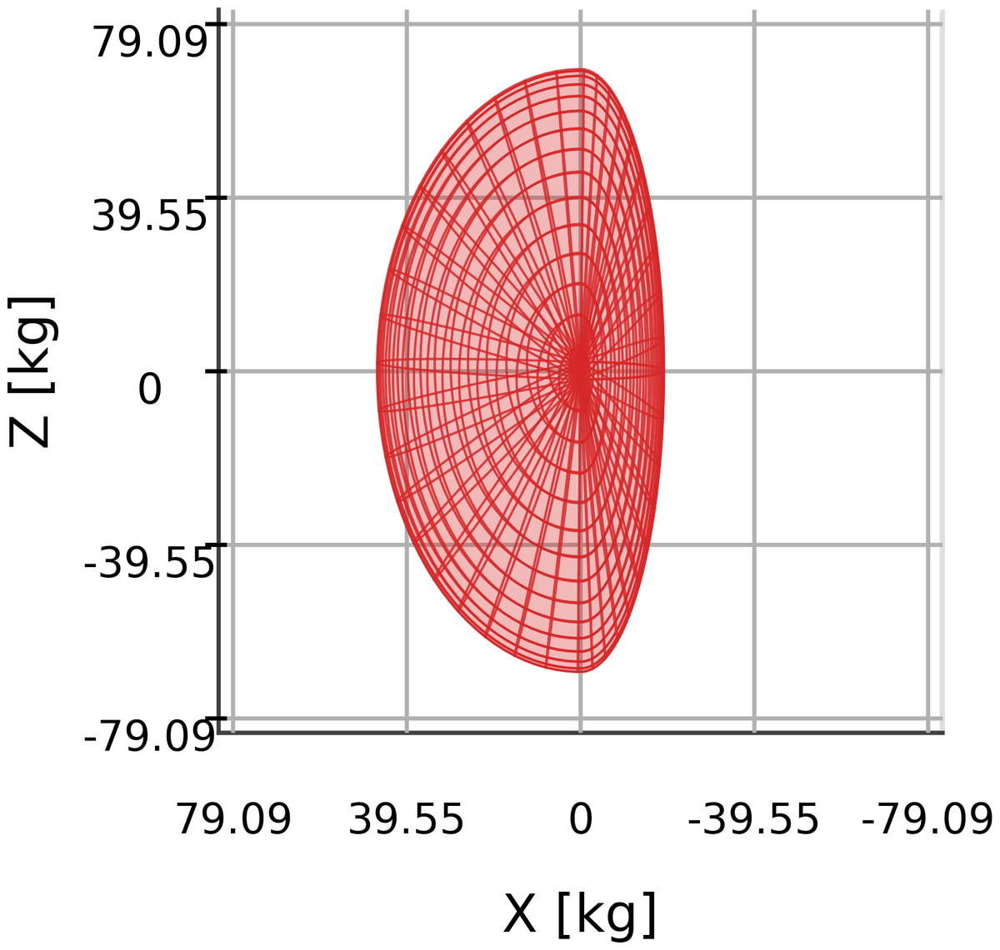 |

At a thigh point under opposite directions **u** and **−u**, the knee DOF
becomes active when the contact force would drive the joint beyond its
admissible range. With the same posture, point, direction, and foot support,
activating the knee ROM constraint raises the thigh effective mass from
19.01 kg to 46.84 kg (about 2.46 times). Because the constraint is active for
only one of the two directions, the surface in (c) is not centrally symmetric.

## System architecture

<p align="center">
  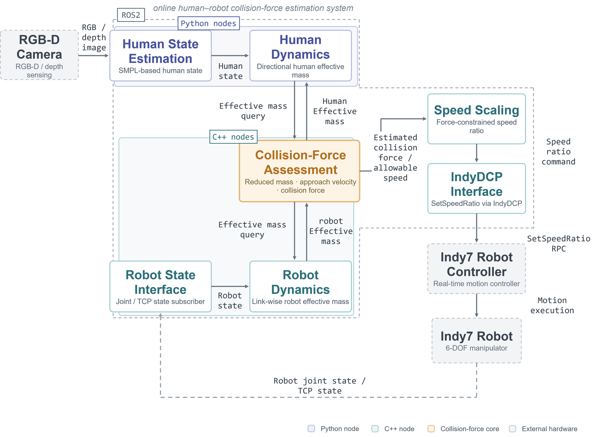
</p>

The RGB-D camera feeds SMPL-based human state estimation, and the human
dynamics node computes the directional human effective mass. The robot
dynamics node computes the link-wise Indy7 effective mass. The collision-force
assessment node combines both into a reduced mass, collision force, and
allowable speed, and the resulting speed ratio is sent to the Indy7 controller
through IndyDCP. Human-side nodes are written in Python and robot-side nodes in
C++.

## Demonstrations

| Real-time SMPL human-state estimation | Top-three collision-risk body parts |
| :---: | :---: |
| 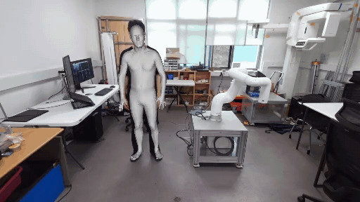 | 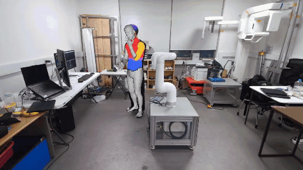 |
| Shape is estimated with CLIFF and pose from RGB-D body tracking; the SMPL mesh is overlaid on the camera image. | Body segments are colored by collision-risk rank: red (1st), yellow (2nd), and blue (3rd). |

## Results

| Head, crouched posture | Upper arm, raised-arm posture |
| :---: | :---: |
| 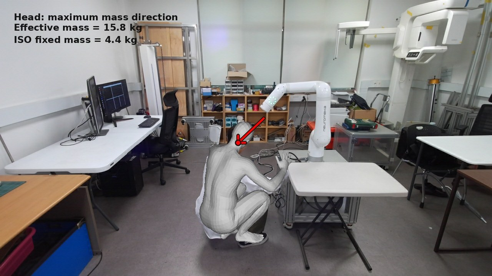 | 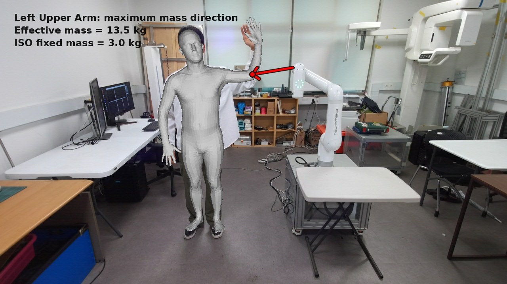 |

Arrows show the collision direction that maximizes the human effective mass.
In these directions the directional effective mass (15.8 kg for the head,
13.5 kg for the upper arm) exceeds the ISO/TS 15066 fixed mass (4.4 kg and
3.0 kg), which raises the estimated collision force by 41.57% and 57.78% at the
decision-boundary speed.

<p align="center">
  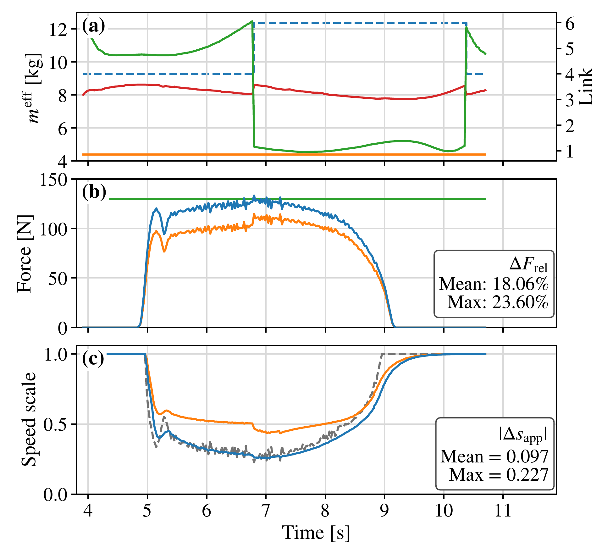
</p>

Online response for the most restrictive candidate pair during the head
approach. (a) Directional human (red), robot (green), and fixed head (orange)
effective masses, with the selected robot link (blue dashed, right axis).
(b) Force estimated with the proposed (blue) and fixed (orange) human mass
against the permissible force (green). (c) Raw (grey dashed) and applied (blue)
speed scale, and the applied scale recomputed offline with the fixed mass
(orange).

- The estimated force differed from the fixed-mass baseline by 18.06% on
  average over the head-approach interval.
- The mean software-side assessment-to-command latency was 26.84 ms.
- Jacobian-based velocity mapping and a BMI-based chest reference showed mean
  relative errors of 3.31% and 5.59%.

These force differences are model-output comparisons, not measured
collision-force validation.

## Repositories

| Repository | Responsibility | Access |
| --- | --- | --- |
| [`hrc_ws-public`](https://github.com/ukhyeon/hrc_ws-public) | Human sensing, 3D pose estimation, human dynamics, visualization, and shared ROS 2 interfaces | Public, clean-history snapshot |
| [`indy_ws`](https://github.com/ukhyeon/indy_ws) | Indy7 communication, robot dynamics, collision-risk assessment, and robot speed control | Public |

`indy_ws` depends on the `hrc_interfaces` package provided by `hrc_ws`.

## Key features

- Camera-based human-body sensing and 3D pose estimation
- Human and robot directional effective-mass estimation
- Candidate collision-pair evaluation
- ISO/TS 15066–related collision-force assessment
- Risk-aware, smoothed robot speed scaling
- Runtime latency and processing-rate measurement
- Experiment analysis and visualization utilities

## Getting the project

The repository includes a
[`human-robot-safety.repos`](human-robot-safety.repos) manifest for
[`vcstool`](https://github.com/dirk-thomas/vcstool). It downloads both component
repositories into one local source directory without duplicating their Git
history.

> [!NOTE]
> The manifest checks out `hrc_ws-public` into a local directory named `hrc_ws`
> so that existing workspace paths and build instructions remain unchanged.

```bash
sudo apt install python3-vcstool

git clone https://github.com/ukhyeon/human-robot-safety-system.git
cd human-robot-safety-system
mkdir -p src
vcs import src < human-robot-safety.repos
```

To inspect the checked-out versions:

```bash
vcs status src
```

To update both repositories:

```bash
vcs pull src
```

## Build order

The shared ROS 2 interfaces must be available before building the robot-side
workspace. Follow the detailed dependency and model setup instructions in each
component repository.

```bash
source /opt/ros/<ros-distro>/setup.bash

cd src/hrc_ws
colcon build --symlink-install
source install/setup.bash

cd ../indy_ws
colcon build --symlink-install
source install/setup.bash
```

Replace `<ros-distro>` with the ROS 2 distribution installed on the system.

## Project management

Use this hub repository for concerns that span the complete system:

- system architecture and integration documentation;
- compatible component versions and releases;
- end-to-end setup and demonstration instructions;
- system-level milestones, issues, and roadmap.

Use the component repositories for implementation-specific issues and changes.
Pin `version` entries in `human-robot-safety.repos` to a release tag or commit
when an experiment must be exactly reproducible.

## Requirements and safety

The complete demonstration requires external model assets, a compatible camera
setup, and access to an Indy7 robot controller. Some body-model assets have
separate licenses and are not distributed through this hub repository.

> [!CAUTION]
> Robot commands can cause physical motion. Verify the controller address,
> workspace clearance, emergency-stop operation, and speed limits before running
> hardware-facing nodes. Test changes at conservative speeds in a controlled
> environment.

## Current status

The system is under active development. Some component configuration paths and
hardware parameters still reflect the original development environment; review
the component README files before attempting reproduction on another machine.
